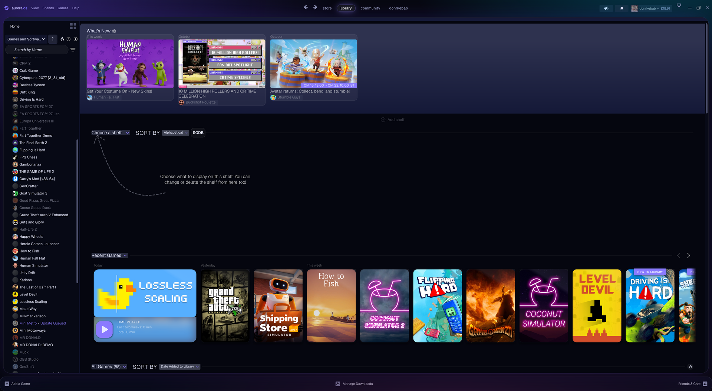
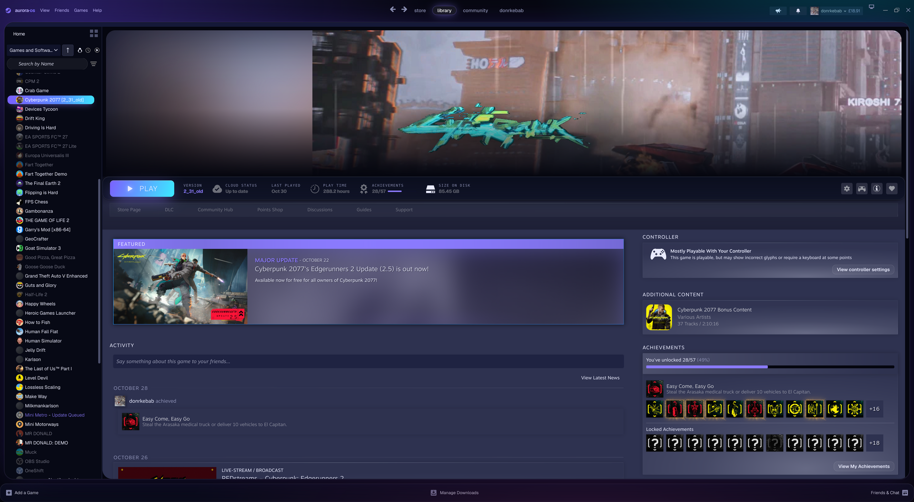
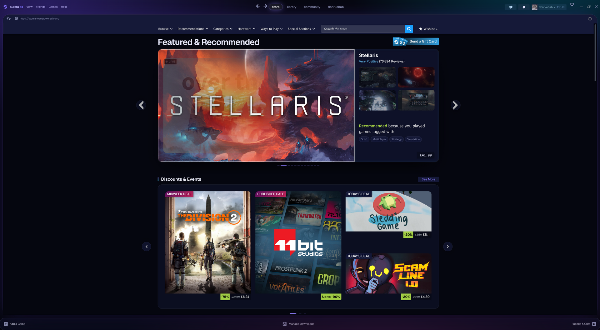

# Aurora

Soft, floating violet glass for the Steam desktop client. The sidebar and shelves sit on rounded glass cards, headings use a lavender gradient, and the selected game gets a glowing pill.

**Includes:** library, game pages, store and community pages, friends and chat, notifications, menus, sign-in screen, downloads.

## Screenshots




## Install
Requires [Millennium](https://steambrew.app). Open Steam → Millennium → Themes → Install a theme, and paste:
```
https://github.com/ethembeldagli/steam-aurora
```

## Settings
Steam → Millennium → Themes → Aurora → ⚙
- **Accent color:** Violet, Mint, Rose, Sky
- **Corners:** default, sharp, extra round
- **Motion:** full or reduced (turns off all animation)
- **Backdrop:** on or off

## License
MIT
